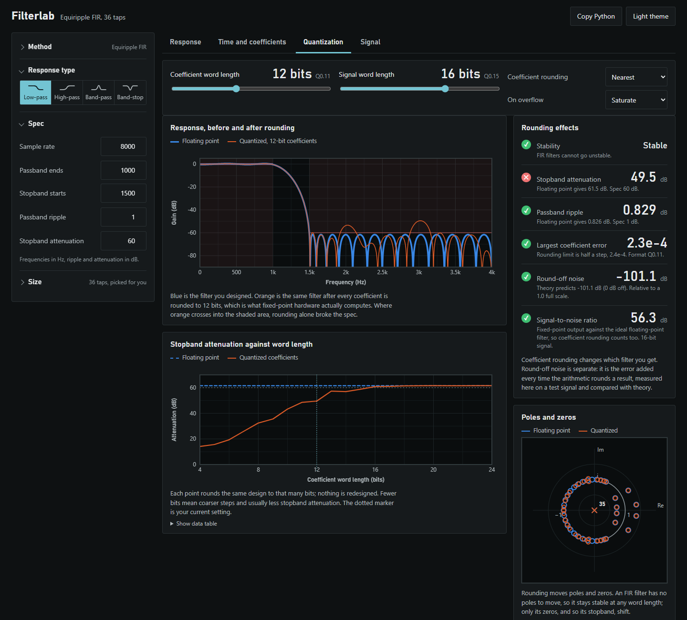
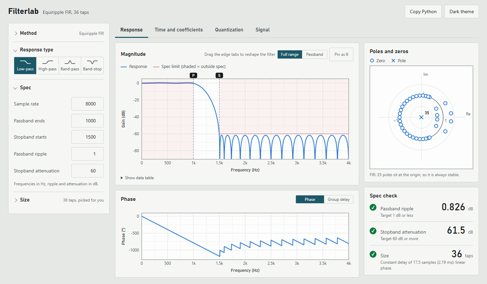
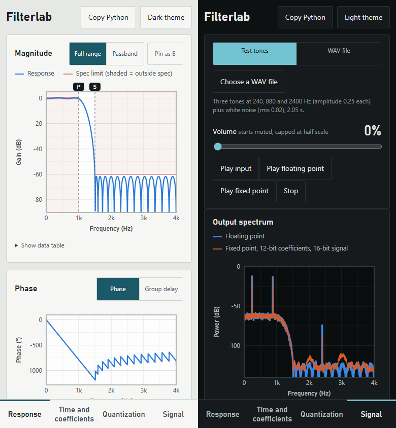

# Filterlab

A digital filter design bench that runs in the browser. Design FIR and IIR filters, see exactly what happens when you round them to fixed-point hardware, and export the result as SystemVerilog you can watch run.



## What it does

**Design**
- FIR by windowing (rectangular, Hann, Hamming, Blackman, Kaiser) and by Parks-McClellan equiripple for all four linear-phase types, odd and even lengths. Hilbert transformers and differentiators are available in the library.
- IIR from Butterworth, Chebyshev I and II, and elliptic prototypes (analog prototype, band transform, bilinear transform, biquad output), with minimum-order estimation from your pass and stop band specs.
- Bode magnitude and phase, group delay, and a pole-zero plot. Band edges are draggable handles on the plot.

**Quantize**
- Choose a word length (Qm.n formats) and see the filter after rounding: the frequency response, the poles and zeros, and the round-off noise. Coefficient rounding covers FIR, the biquad cascade and a single direct form.
- A bit-true fixed-point simulator for FIR and cascaded second-order sections, with saturate or wrap overflow, input headroom, and optional error feedback.
- Measured round-off noise next to the theoretical prediction.

**Build hardware**
- Export a quantized FIR (direct or transposed form) or biquad cascade as SystemVerilog, with a self-checking testbench and a vectors file.
- Run the generated hardware in the browser. A built-in interpreter executes the generated SystemVerilog one clock at a time, shows the waveform, and compares every output sample with the bit-true model.
- A cost report with multiplier counts, shift-and-add adders, and register bits. It reports counts only, not area or speed.

**Try it on signals**
- Send test tones or a WAV file through the design and compare the floating-point and fixed-point output spectra.

## Run it

Open `web/index.html` in a browser. It is one self-contained file: nothing to install, and no network needed.

After editing anything in `web/` (`dsp.js`, `rtl.js`, `rtlsim.js`, `app.js`, `style.css`, `index.template.html`), rebuild the page with `npm run build` (or `python web/build.py`); `web/index.html` is generated, so do not edit it by hand. To view it in VS Code's Simple Browser, run `npm run serve` (it needs Python) and open `http://localhost:8000/`. On Windows PowerShell, if scripts are blocked, use `npm.cmd run ...`.

## How it was checked

The tests need Python 3 with numpy and scipy, Node 22 or newer, and Edge or Chrome. There are no npm packages.

| Check | Command | What it covers |
|---|---|---|
| Python vs scipy | `npm run test:py` | Windows, Remez, IIR design, order estimates, filter responses, measured noise vs theory |
| Python vs JavaScript | `npm run test:js` | The browser code matches the Python library at machine precision, including poles and zeros and the generated SystemVerilog text |
| RTL structure and arithmetic | `npm run test:rtl` | Generated SystemVerilog against an independent Python evaluator; Icarus Verilog runs too if it is installed |
| In-browser hardware simulation | `npm run test:rtlsim` | The interpreter against the bit-true models on 10 designs, with a deliberately broken coefficient that must be caught |
| User interface | `npm run test:ui` | Rebuilds the page, then checks that every method and response type meets its spec in the real page, with no console errors, and takes screenshots |
| Everything | `npm run test:all` | All of the above, in order; stops at the first failure |

Two statements about the hardware side are worth keeping precise:

- **The SystemVerilog has not been run in a standard HDL simulator or synthesized.** The generator and the interpreters that check it were written in this project, so they share one reading of the language rules. Installing Icarus Verilog and running `npm run test:rtl` is the step that would close that gap (see [Hardware export](#hardware-export-systemverilog)).
- **The cost report is a count of operations.** It makes no claim about area, clock speed or power.

**Python launcher.** `run_tests.js` uses the first of `python`, `py -3`, `python3` that can import numpy.
On the development machine (Windows 11) that is `python` (3.12); `python3` there is the Microsoft Store stub.
Run the scripts directly with the same launcher, e.g. `python -m pytest tests -q`.

**Browser.** The UI tests drive headless Edge or Chrome over the DevTools protocol (`tests/browser.js`).
Set `EDGE_PATH` or `CHROME_PATH` to choose one; otherwise the usual install locations are searched.
Screenshots go to `shots/` (light and dark, 1440 and 390 px wide). Both UI scripts exit non-zero on a missed
spec, a failed interaction check or any console error.

## Why this exists

I built Filterlab to connect three things I want to work on: signal processing, digital hardware, and the numerics that sit between them. A filter that looks right in floating point can lose its stop band or overflow once it is rounded to a few bits. Filterlab shows that happening and then gives you the hardware description of the version that survived.

## Project layout

```
dsp/        Python library: filter design, analysis, fixed-point, RTL generation (numpy only)
web/        Browser app: dsp.js (port of dsp/), rtl.js, rtlsim.js (interpreter), app.js, style.css; build.py -> index.html
tests/      pytest vs scipy, the JS cross-check, the RTL evaluator, the interpreter check, interface tests
docs/       Theory, RTL notes, UI design notes, design decisions, status, screenshots
examples/   Scripts that use the library directly: demo.py (writes gallery.png), rtl_export.py
```

See `docs/theory.md` for the math (including how each biquad is scaled), `docs/rtl.md` for the generated module's interface and latency, and `docs/DECISIONS.md` for the choices made along the way and why.

## Python

```python
from dsp import *

# Equiripple low-pass: 1 dB ripple, 60 dB stopband, 1000 -> 1500 Hz at fs = 8 kHz
dp = (10**(1/20) - 1) / (10**(1/20) + 1); ds = 10**(-60/20)
h = remez(37, [0, 1000, 1500, 4000], [1, 0], weight=[1/dp, 1/ds], fs=8000)

# Chebyshev I, order from the spec, as biquads
n = min_order("cheby1", "lowpass", [1000], [1500], 1, 60, fs=8000)
d = design_iir("cheby1", "lowpass", n, 1000, fs=8000, rp=1)      # d["sos"], d["b"], d["a"], d["z"], d["p"]

# What does 10-bit arithmetic do to it?
fmt, sq, gain = quantize_sos(d["sos"], 10)                      # per-section peak scaling + shared Qm.n format
f, H = sos_freqz(sq, 2048, fs=8000); H *= gain

# Even length (type II), Hilbert transformer (type III/IV), elliptic
h2 = remez(36, [0, 1000, 1500, 4000], [1, 0], weight=[1/dp, 1/ds], fs=8000)
hh = remez(31, [200, 3800], [1], fs=8000, kind="hilbert")
e = design_iir("ellip", "lowpass", min_order("ellip", "lowpass", [1000], [1500], 1, 60, fs=8000), 1000, fs=8000, rp=1, rs=60)

# Bit-true cascade: wrap-around overflow, 2 bits of input headroom, error feedback
import numpy as np; x = 0.5 * np.sin(2 * np.pi * 300 / 8000 * np.arange(4000))
y = simulate_sos_fixed(sq, x, fmt, QFormat(0, 15), overflow="wrap", headroom_bits=2, error_feedback=True) * gain * 2**2
```

Conventions: edges are in Hz (pass `fs`), `sos` rows are `[b0 b1 b2 1 a1 a2]`, Qm.n means 1 sign bit + m integer bits + n fraction bits.

## Hardware export (SystemVerilog)

`dsp/rtl.py` turns a quantized design into a synthesizable SystemVerilog module whose output matches the bit-true
simulators (`simulate_fir_fixed`, `simulate_sos_fixed`) sample for sample: FIR in direct or transposed form, IIR as a
direct-form-I biquad cascade with saturate/wrap overflow, input headroom and error feedback. It also writes a
self-checking testbench and a `$readmemh` vectors file. `web/rtl.js` produces byte-identical text, and the
Quantization tab's Hardware export card offers it for the current design.

**Status: generated, not synthesized, not run in a standard HDL simulator.** No HDL simulator was available where
this was built. Two interpreters written for this project execute the generated text and match the bit-true
simulator exactly: `tests/rtl_eval.py` in pytest, and `web/rtlsim.js` in the tests and in the browser. Because the
generator and both interpreters come from the same project, that agreement is weaker evidence than a third-party
simulator. Install [Icarus Verilog](https://steveicarus.github.io/iverilog/) and run `npm run test:rtl` to simulate
8 designs with a standard tool. Interface, latency, accumulator widths and how to simulate:
[docs/rtl.md](docs/rtl.md). Example: `python examples/rtl_export.py`.

**Simulate hardware (in the browser).** Under the export card, the Quantization tab runs the exported module
through `web/rtlsim.js`, an interpreter for exactly the SystemVerilog subset the generator emits. It parses the
module text and runs it one clock at a time with SystemVerilog's signed/unsigned width rules and BigInt values. You
choose an impulse, step, square, sine or seeded-noise input of 16 to 256 samples, step one clock at a time or run to
the end, and read every value at the waveform cursor as an integer and as a Qm.n number. A live line reports
"RTL output vs bit-true model: N of N samples identical", or the first clock where they differ. Anything outside
the subset is rejected as an "unsupported construct", never guessed. Limits are in
[docs/rtl.md](docs/rtl.md#in-browser-simulation).

## Interactive app

Pick a method and response type, drag the P and S tabs on the magnitude plot to move the band edges, and the filter is redesigned live. "Pin as B" keeps the current magnitude response on the plot (dashed) so you can compare the next design against it. The Quantization tab shows the response and poles before and after rounding, a word-length sweep, measured against predicted round-off noise, and, for IIR filters, a diagram of one biquad with its rounding point. It also has controls for overflow (saturate or wrap), input headroom and error feedback. "Copy Python" reproduces the current design with this library. The Signal tab runs a seeded test signal (three tones plus noise) or a WAV file you upload through the current design, in floating point and bit-true fixed point. It shows the input and output spectra and the first samples, and can play each one (playback starts muted and is capped at half scale). On a phone the views are on a tab bar at the bottom, and each view opens on its plot with the design controls below it.

The look is a bench instrument. Each plot is a recessed screen with a graticule, and the readouts (ripple,
attenuation, taps, word lengths, SNR) are large tabular numbers with small units. Light and dark themes are designed
separately. Floating-point traces are blue and wide; quantized traces are orange and thin, so the two differ by line
weight as well as colour. The design notes are in [docs/ui-design.md](docs/ui-design.md).

**Interacting with it.**
- Hovering any Response plot shows the same frequency on magnitude, phase and the pole-zero plot (the point e^jω on the unit circle).
- Dragging a word-length or order slider redraws live, with the previous trace left faint behind the new one.
- Five themes are in the header (Instrument light and dark, Swiss, Phosphor, Paper), and your choice is remembered.
- Keyboard: `1`-`4` switch tabs, `T` changes theme, `S`/`R` step or run the hardware simulator, `G` starts a six-step guided tour (it never starts on its own), `D` downloads a spec-sheet drawing (SVG) with dimension lines and the spec check, and `?` lists the shortcuts.
- "Explore: drag poles and zeros" lets you move a copy of the roots and see a dashed what-if response. It is labelled as exploration and never changes the design or its spec check.
- With reduced motion set in your system, nothing animates.





## Python and JavaScript names

`web/dsp.js` is a line-for-line port of `dsp/`, cross-checked by `tests/cross_check.js`. Python names are
snake_case and JavaScript names are camelCase; keyword-only Python options become an options object in JS.

| Python (`dsp/`) | JavaScript (`web/dsp.js`) | Notes |
|---|---|---|
| `window(name, N, beta)` | `windowFn(name, N, beta)` | |
| `kaiser_params(atten_db, transition_hz, fs)` | `kaiserParams(atten, transition, fs)` | JS returns `{numtaps, beta}` |
| `fir_window(numtaps, edges, kind, win, fs, beta)` | `firWindow(numtaps, edges, kind, win, fs, beta)` | |
| `remez(numtaps, bands, desired, weight, fs, ..., *, kind)` | `remez(numtaps, bands, desired, weight, fs, {kind, gridDensity, maxiter, tol})` | JS returns `{h, delta, iterations}` |
| `design_iir(kind, btype, order, edges, fs, rp, rs, butter_edge_rp)` | `designIIR(kind, btype, order, edges, fs, rp, rs, protoScale)` | JS scales the prototype directly instead of taking `butter_edge_rp` |
| `min_order(kind, btype, passband, stopband, gpass_db, gstop_db, fs)` | `minOrder(kind, btype, passband, stopband, gp, gs, fs)` | |
| `zpk2sos`, `sos2tf` | `zpk2sos`, `sos2tf` | |
| `roots_of(p)` | `polyRoots(p)` | |
| `freqz`, `sos_freqz`, `group_delay` | `freqz`, `sosFreqz`, `groupDelay` / `sosGroupDelay` | |
| `measure_lowpass(f, H, fp, fst)` | `measure(resp, bands)` | JS measures any band layout |
| `QFormat(int_bits, frac_bits)` | `qFormat(intBits, fracBits)` | |
| `auto_format`, `to_int(x, fmt, rounding, overflow)`, `quantize` | `autoFormat`, `toInt(x, fmt, rounding, overflow)`, `quantize` | |
| `quantize_fir`, `scale_sos`, `quantize_sos`, `quantize_direct_form` | `quantizeFir`, `scaleSos`, `quantizeSos`, `quantizeDirect` | JS returns objects, not tuples |
| `simulate_fir_fixed(h, x, coef_fmt, sig_fmt, *, overflow)` | `firFixedSim(h, x, coefFmt, sigFmt, rounding, {overflow})` | |
| `simulate_sos_fixed(sos, x, coef_fmt, sig_fmt, *, overflow, headroom_bits, error_feedback)` | `sosFixedSim(sos, x, coefFmt, sigFmt, rounding, {overflow, headroomBits, errorFeedback})` | JS also returns the float references `yq`, `yIdeal` |
| `fir_noise_theory(h, sig_fmt, input_quantized=True)` | `firNoiseTheory(h, sigFmt, inputQuantized = true)` | |
| `sos_noise_theory(sos, sig_fmt, input_quantized=True, *, error_feedback)` | `sosNoiseTheory(sos, sigFmt, inputQuantized = true, {errorFeedback})` | |
| `tone_signal(n, fs, tones, noise_rms, seed)` | `toneSignal(n, fs, tones, noiseRms, seed)` | same seeded generator (mulberry32), bit-identical |
| `power_spectrum_db(x, fs, nfft)` | `powerSpectrumDb(x, fs, nfft)` | Welch, Hann, 50 % overlap; full-scale sine = 0 dB |
| (none) | `parseWav(arrayBuffer)` | browser upload only: PCM 16/24-bit or float32, mono/stereo, at most 10 s |

## Design notes and limits

- **Remez** designs all four linear-phase types. Even-length symmetric filters (type II) have a forced zero at fs/2, so they are rejected for high-pass and band-stop; the app tries one tap fewer as type II for low- and band-pass and keeps it only if it still meets the spec. Hilbert transformers and differentiators are in the library and the JS port, not in the app (its pass/fail spec model does not fit them).
- **Elliptic** designs and orders match `scipy.signal.ellip` / `ellipord` (Jacobi functions by the AGM, degree equation by nomes). See `docs/theory.md`.
- **Window method** sizes: Kaiser's formula is an estimate, so the app adds taps until the measured response meets the spec. Fixed windows have a hard attenuation floor (Hamming about 53 dB); the app says so rather than adding taps forever.
- **Butterworth** is designed so the response is exactly -Rp dB at the passband edge (`butter_edge_rp`), which makes the spec meaningful; the textbook -3 dB cutoff is the default in the library.
- **Biquad scaling**: narrow-band filters have numerator coefficients near 1e-4, which a shared fixed-point format rounds to zero. `scale_sos` gives each section unit peak gain and returns the leftover gain as one output stage, as fixed-point code does.
- **Noise model**: direct-form-I biquads with one rounding per section; each rounding error is shaped by that section's own `1/A(z)` and then by the remaining sections. FIR: one rounding at the output. Measured against theory in the tests (within 1 to 2 dB).
- **Error feedback** subtracts `round(a1) r[n-1] + round(a2) r[n-2]` (r = what rounding discarded) before each rounding, so the error is shaped by `(1 + round(a1) z^-1 + round(a2) z^-2) / A(z)`. On a narrow low-pass this lowers the noise by about 26 dB, matching theory to within 0.1 dB.
- **Overflow and headroom**: saturate clamps each section output, wrap keeps the low bits. Headroom scales the input by `2^-h` (h bits of margin, 6.02 h dB less signal-to-noise); multiply the output by `gain * 2^h`.
- Fixed-point simulation in the browser uses doubles, exact up to 2^53, so signal and coefficient words are limited to 20 and 24 bits there.
