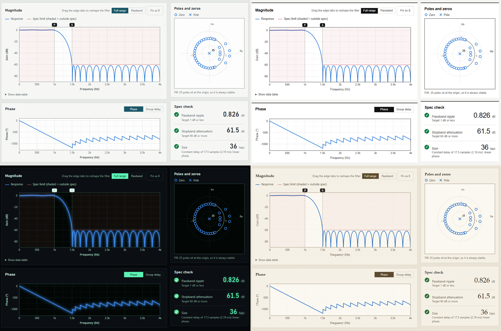

# Design directions (2026-11-19)

**Process.** oil-ui and the awwwards MCP are not available in this session (see the tool inventory in `docs/RUNLOG.md`), so:
- No external references were pulled.
- The directions were built by hand, as real themes of the app, not as mockups.

| Direction | Character | Strength | Risk |
|---|---|---|---|
| **Instrument** (current) | grey bench panel, recessed screens, DIN readouts | reads as a measuring tool; the screens carry the colour | quiet, can look plain |
| **Swiss / Minimal** | white sheet, black rules, no radius, one grotesque | the clearest hierarchy; prints well | austere; the plots lose their "screen" identity |
| **Phosphor** | CRT black-green, glowing traces | the most striking; matches an oscilloscope | glow and dark make long reading tiring; an acid accent is a known generic tell |
| **Paper** | warm notebook sheet, grain, serif headings | calm, good for long reading | warm cream with orange is a known generic tell; softer contrast |

**Pick: Instrument stays the default.** The others ship as opt-in themes.

**Reason.** The tool's job is measurement, read many times a session. Instrument puts all of its contrast into the screens and the readouts, and keeps the rest quiet. That is the scoring the earlier critique asked for. Of the other three:
- Phosphor is more memorable, but costs reading comfort.
- Swiss is clearer still, but drops the screen metaphor that ties the plots together.
- Paper is pleasant, but the softest for data.

Each is still worth offering for a reader who prefers it, because every one passes the palette and contrast checks.

**Taste dials, applied by hand** (taste-skill is absent):

| Dial | Setting | Meaning |
|---|---|---|
| Layout variety | 3/10 | The same grid in every theme; only the surfaces change. |
| Motion | 3/10 | Only in answer to an action, under 250 ms. |
| Density | 7/10 | An engineering tool shows a lot at once; spacing stays on the 8-32 px scale. |

**Impeccable anti-pattern check on the pick:**
- no eyebrows, gradient text, glass, side bars on boxes or hard offset shadows;
- no nested cards apart from the segmented control already logged as a false positive;
- the accent is used only for selection and focus.

**Identity.** brand-identity is absent, so the current wordmark (Filterlab in the display face) and palette are kept. No new mark was drawn.
